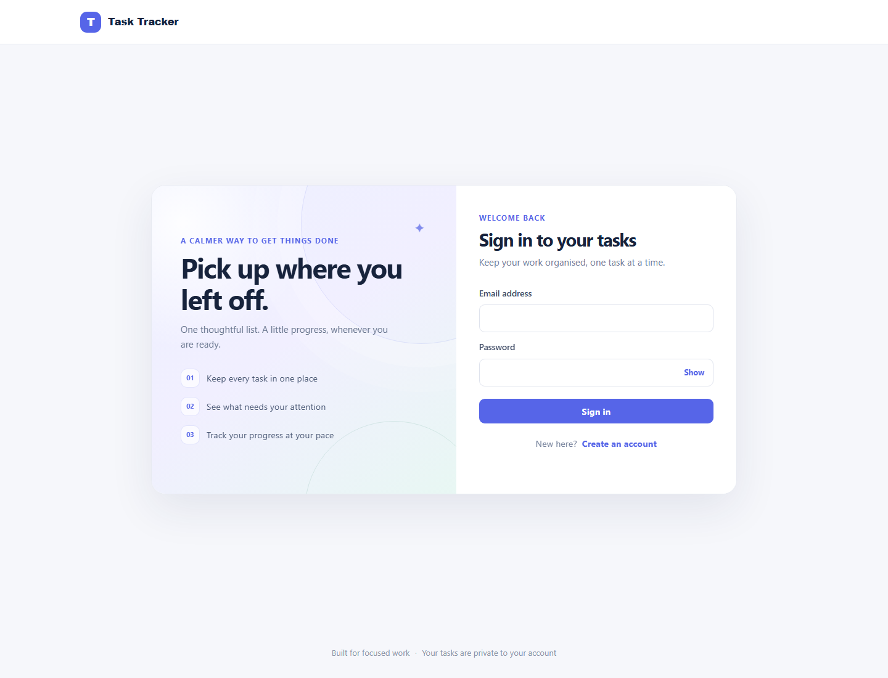
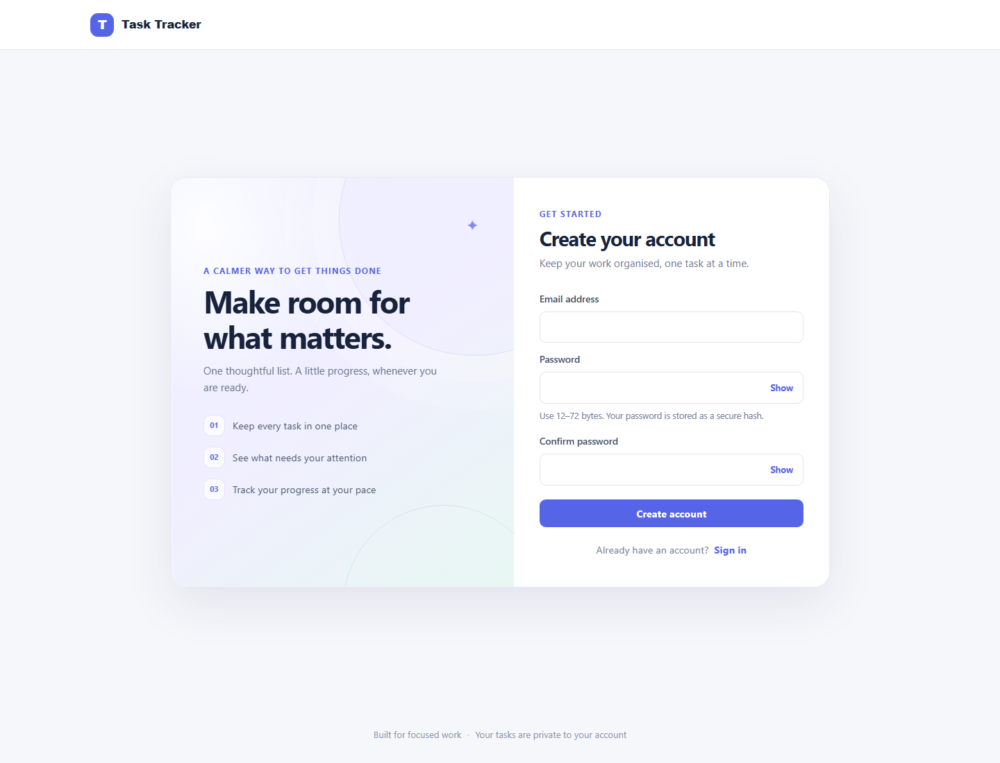
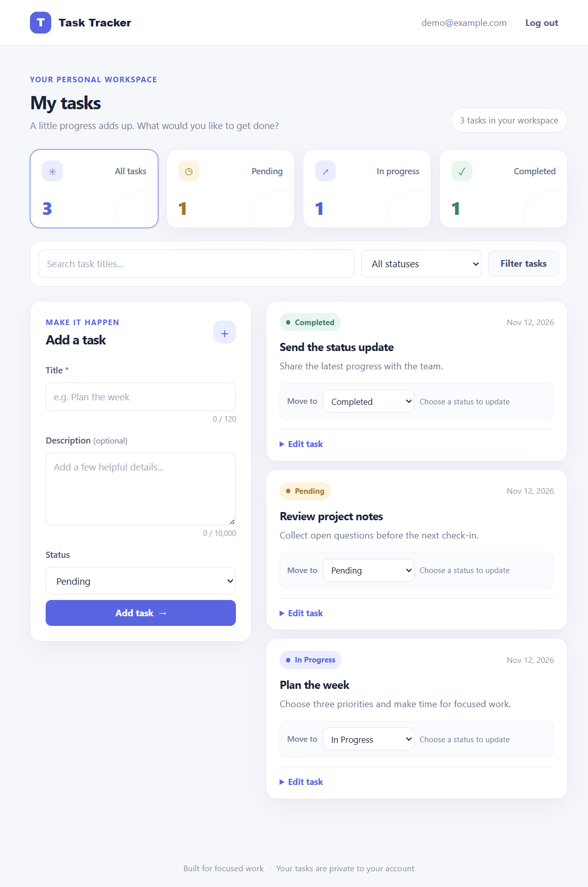
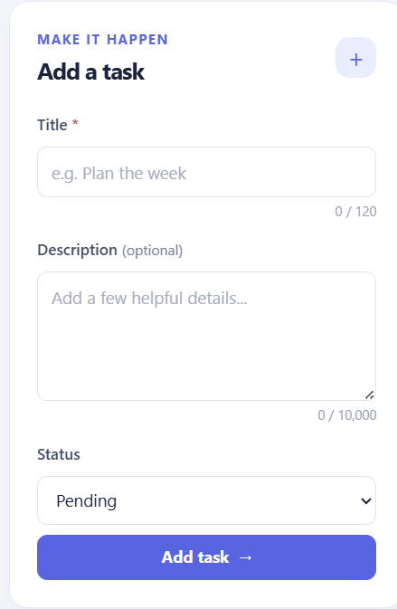
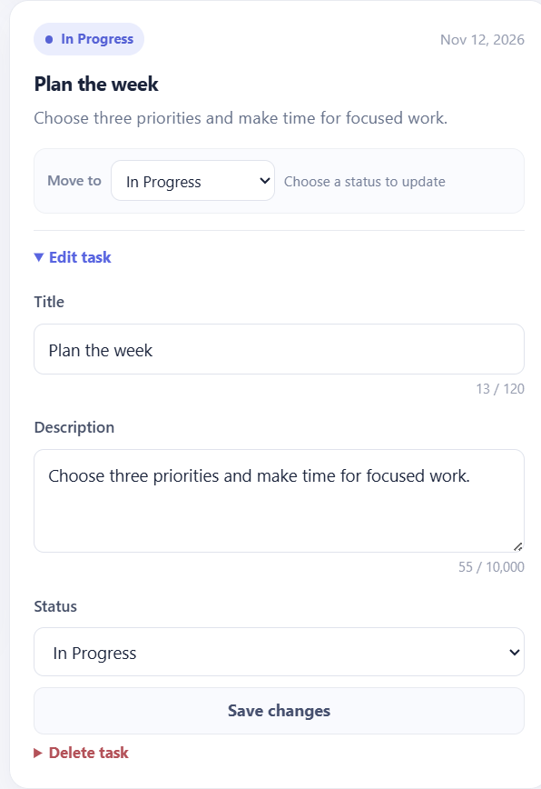
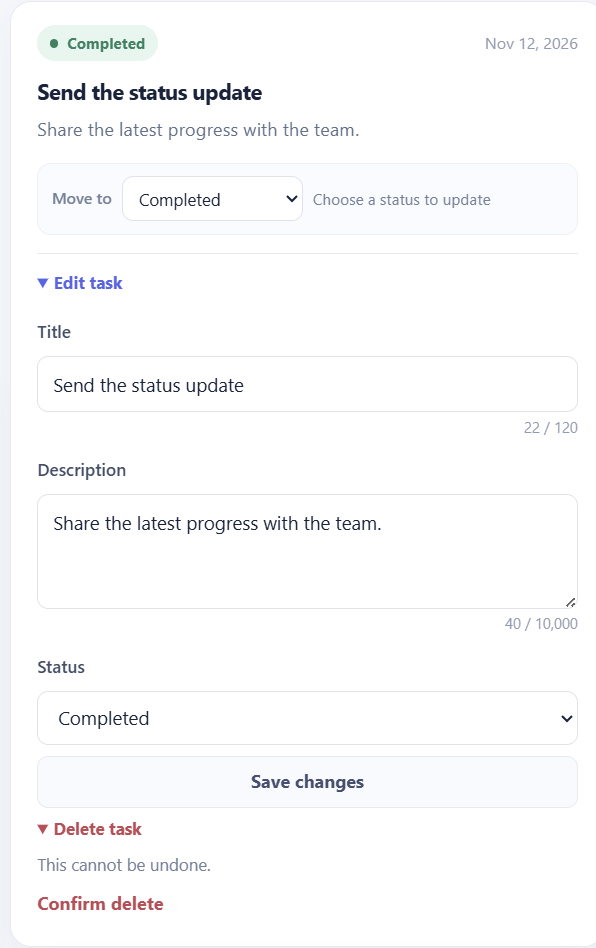
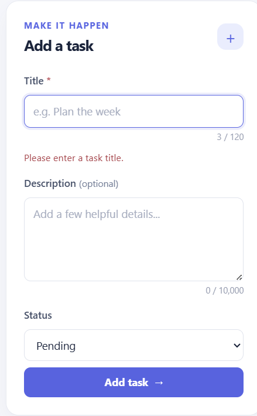
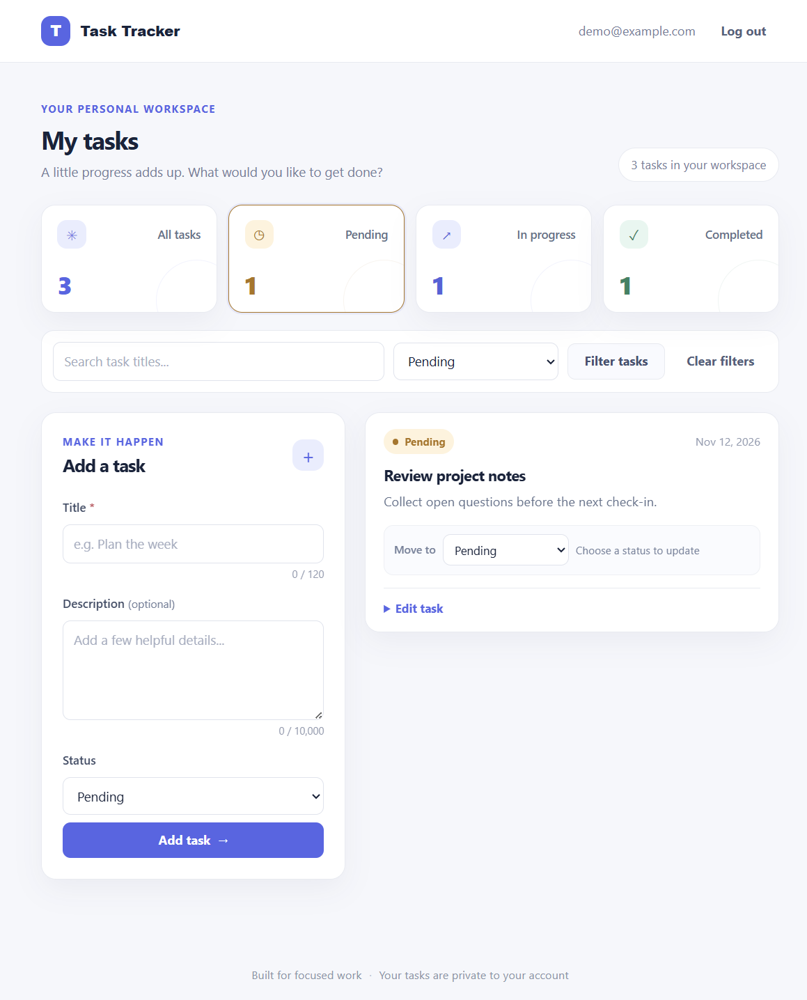
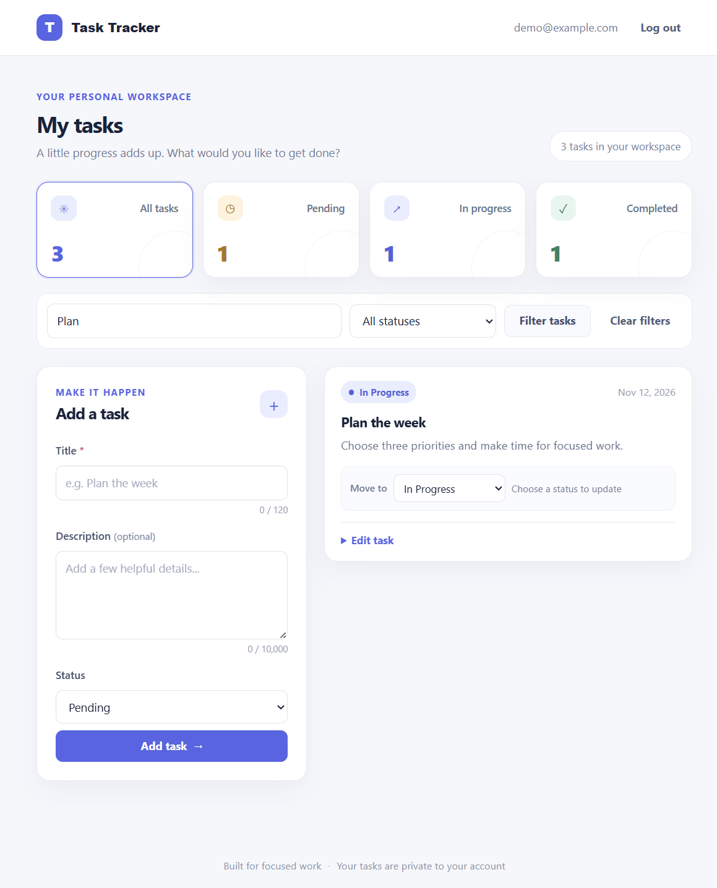
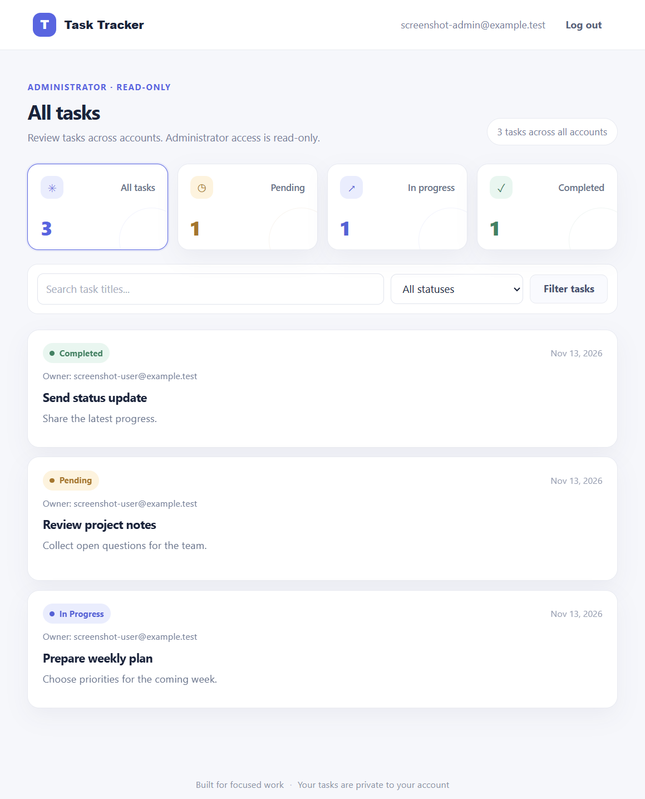

# Task Tracker

A responsive task manager built with **plain PHP** and **MySQL**. Users register, sign in, and manage their own tasks; administrators can review all tasks in a read-only dashboard.

No Composer packages, frontend libraries, or build tools are needed.

---

## Table of Contents

1. [Features](#features)
2. [Assignment Coverage (Levels Completed)](#assignment-coverage-levels-completed)
3. [Roles and Permissions](#roles-and-permissions)
4. [Database Design](#database-design)
5. [Tech Stack](#tech-stack)
6. [Project Structure](#project-structure)
7. [Prerequisites](#prerequisites)
8. [Quick Start (TL;DR)](#quick-start-tldr)
9. [Step-by-Step Setup — Windows](#step-by-step-setup--windows)
10. [Step-by-Step Setup — macOS / Linux](#step-by-step-setup--macos--linux)
11. [Using the App](#using-the-app)
12. [Screenshots](#screenshots)
13. [Test Login Details](#test-login-details)
14. [Running the Tests](#running-the-tests)
15. [Test Cases and Results](#test-cases-and-results)
16. [Troubleshooting](#troubleshooting)
17. [Security Notes](#security-notes)
18. [Backup and Restore](#backup-and-restore)
19. [Production Notes](#production-notes)
20. [Known Limitations](#known-limitations)
21. [GitHub Repository and Forking](#github-repository-and-forking)
22. [Copyright and License](#copyright-and-license)

---

## Features

- **Accounts:** register and sign in with email and password (hashed with `password_hash()`).
- **Private tasks:** regular users can only see or change their own tasks.
- **Administrator dashboard:** administrators can view and filter tasks across accounts, but cannot change them.
- **Task management:** create, edit, and delete tasks (with a confirmation before deleting).
- **Status:** `Pending`, `In Progress`, `Completed`, with quick status changes on each task card.
- **Search & filter:** live search by title and filter by status (clickable status summaries).
- **Validation:** friendly client-side and server-side validation with character/byte counters.
- **Password helpers:** show/hide password, confirm-password check, and a length guide.
- **Security:** PDO prepared statements, CSRF tokens on state-changing forms, escaped output, secure session cookies, and security headers.

## Assignment Coverage (Levels Completed)

| Level | Status | What is implemented |
|---|---|---|
| **Level 1** — Basic task management | ✅ Complete | `tasks` table; add task (title + description); list tasks; edit; delete with confirmation; success messages; fields `id`, `title`, `description`, `status`, `created_at`. |
| **Level 2** — Status, search, validation | ✅ Complete | Pending / In Progress / Completed; status change; title search; status filter; client- and server-side validation with friendly errors. |
| **Level 3** — Login, authorization, security | ✅ Complete | Registration + login; `password_hash()` / `password_verify()`; dashboards require sign-in; user task ownership checks; a read-only administrator dashboard; PDO prepared statements; escaped output; CSRF tokens. |
| **Bonus** | Partial | Dashboard summary (total / pending / in-progress / completed counts, clickable) and read-only administrator view. Pagination, due dates and priority are **not** included. |

## Roles and Permissions

- There are two roles: **`user`** and **`admin`**. Registration creates `user` accounts; the SQL demo data also seeds `demo-admin@example.com` as an administrator. A trusted operator must provision any additional admin accounts.
- A user can **create, view, edit, change the status of, and delete only their own tasks**.
- An administrator can view and filter tasks across accounts, but all task changes are rejected.
- Authorization is enforced **in the backend**: user task queries include `user_id = <signed-in user>` (for example `... WHERE id = :id AND user_id = :user_id`). Changing a task ID in the URL or form never gives a regular user access to another account's data.
- Signed-out visitors are redirected to the sign-in page for the dashboard.

## Database Design

| Table | Purpose | Key fields |
|---|---|---|
| `users` | Accounts | `id` (PK), `email` (unique), `password_hash`, `role` (`user` or `admin`), `created_at` |
| `tasks` | Tasks | `id` (PK), `user_id` (FK → `users.id`, `ON DELETE CASCADE`), `title` (max 120), `description`, `status` (`ENUM` of the 3 statuses), `created_at`, `updated_at` |

Design choices: a foreign key links each task to exactly one owner and removes a user's tasks if the user is deleted; `status` is an `ENUM` so invalid values cannot be stored; indexes on `(user_id, status, created_at)` and `(user_id, title)` support dashboard filtering and title search; `utf8mb4` supports all characters. The single `database.sql` file creates or upgrades the schema and seeds two demo accounts plus three sample tasks for the regular demo account. Re-importing it resets the seeded accounts' password hashes and roles.

---

## Tech Stack

| Layer    | Technology                                   |
|----------|----------------------------------------------|
| Backend  | PHP 8.1+ (PDO, no framework)                 |
| Database | MySQL 8.0+ (or compatible MariaDB)           |
| Frontend | Vanilla JavaScript and CSS (no libraries)    |
| CI       | GitHub Actions (PHP lint + helper tests)     |

## Project Structure

```
Task-Tracker/
├── public/                  # Web root — the only folder served to the browser
│   ├── index.php            # Front controller (routes, auth, task logic, views)
│   └── assets/
│       ├── app.js           # Search, password toggle, counters, confirmations
│       └── style.css        # Responsive styles
├── app/
│   ├── database.php         # PDO connection (reads DB_* environment variables)
│   └── helpers.php          # Escaping, CSRF, flash messages, validation
├── tests/
│   ├── run.php              # Dependency-free helper tests
│   └── integration.php      # Database-backed HTTP integration tests
├── screenshots/             # Ten screenshots of auth and dashboard flows
├── database.sql             # Creates schema and inserts demo accounts and tasks
├── .env.example             # Names of the required environment variables
└── .github/workflows/php.yml
```

## Prerequisites

| Requirement | Version                | How to check                               |
|-------------|------------------------|--------------------------------------------|
| PHP         | 8.1 or newer           | `php -v`                                   |
| PDO MySQL   | enabled in PHP         | `php -m` (must list `PDO` and `pdo_mysql`) |
| MySQL       | 8.0+ (or MariaDB)      | `mysql --version`                          |
| Browser     | Any modern browser     | —                                          |

You do **not** need Composer, Node.js, or a web server such as Apache/Nginx. PHP's built-in server is enough for local use.

---

## Quick Start (TL;DR)

If PHP and MySQL are already installed and working:

```sh
# 1. Create the database and tables
mysql -u root -p < database.sql

# 2. Create an app-only database user (run inside `mysql -u root -p`)
#    CREATE USER 'task_tracker'@'127.0.0.1' IDENTIFIED BY 'your-strong-password';
#    GRANT SELECT, INSERT, UPDATE, DELETE ON task_tracker.* TO 'task_tracker'@'127.0.0.1';

# 3. Set connection variables, then start the server from the project root
export DB_HOST=127.0.0.1 DB_PORT=3306 DB_NAME=task_tracker DB_USER=task_tracker DB_PASS='your-strong-password'
php -S 127.0.0.1:8000 -t public

# 4. Open http://127.0.0.1:8000
```

(On Windows PowerShell, use `$env:DB_HOST = "127.0.0.1"` style variables — see below.)

---

## Step-by-Step Setup — Windows

Use **Windows 10/11 with PowerShell**. Run every command from the same PowerShell window unless told otherwise.

### Step 1 — Install PHP

1. Download a PHP 8.1+ **x64 Thread Safe** zip from <https://windows.php.net/download/>.
2. Extract it to a folder such as `C:\php`.
3. Add `C:\php` to your Windows `PATH` (Start → "Edit the system environment variables" → Environment Variables → Path → New).
4. Open a **new** PowerShell window and verify:

   ```powershell
   php -v
   ```

### Step 2 — Enable the MySQL PDO extension

1. Find which `php.ini` PHP loads:

   ```powershell
   php --ini
   ```

   If it says *"Loaded Configuration File: (none)"*, copy `C:\php\php.ini-development` to `C:\php\php.ini`.
2. Open `php.ini` and make sure these lines are **not** commented out (no leading `;`):

   ```ini
   extension_dir = "ext"
   extension=pdo_mysql
   ```

3. Save, open a **new** PowerShell window, and verify:

   ```powershell
   php -m | findstr /I "PDO pdo_mysql"
   ```

   The output must include both `PDO` and `pdo_mysql`.

### Step 3 — Install and start MySQL

1. Install **MySQL Server 8.0+** with the [MySQL Installer](https://dev.mysql.com/downloads/installer/).
2. Set a `root` password during setup and **remember it**.
3. Make sure the MySQL service is running (Services → *MySQL80* → Running).
4. Open a **new** PowerShell window and verify:

   ```powershell
   mysql --version
   ```

   If `mysql` is not recognized, add `C:\Program Files\MySQL\MySQL Server 8.0\bin` to `PATH`, then open a new window.

### Step 4 — Open the project folder

Unzip the project, then in PowerShell go to the folder that contains `database.sql`:

```powershell
cd "C:\path\to\Task-Tracker"
Get-ChildItem database.sql
```

(Or open the folder in VS Code and use **Terminal → New Terminal**.)

### Step 5 — Create the database and tables

```powershell
cmd.exe /c "mysql -u root -p < database.sql"
```

Enter your MySQL `root` password when asked. This creates the `task_tracker` database with the `users` and `tasks` tables.

### Step 6 — Create a limited database user for the app

The app should **not** connect as `root`. Log in as root:

```powershell
mysql -u root -p
```

At the `mysql>` prompt, run (replace the password with your own strong one):

```sql
CREATE USER 'task_tracker'@'127.0.0.1' IDENTIFIED BY 'replace-with-your-own-strong-password';
GRANT SELECT, INSERT, UPDATE, DELETE ON task_tracker.* TO 'task_tracker'@'127.0.0.1';
EXIT;
```

> If the user already exists, use `ALTER USER 'task_tracker'@'127.0.0.1' IDENTIFIED BY 'new-password';` instead of `CREATE USER`, then run the `GRANT` line again.

### Step 7 — Set the connection variables

In the **same PowerShell window** you will use to start the app:

```powershell
$env:DB_HOST = "127.0.0.1"
$env:DB_PORT = "3306"
$env:DB_NAME = "task_tracker"
$env:DB_USER = "task_tracker"
$env:DB_PASS = "replace-with-your-own-strong-password"
```

- Use the **same password** you chose in Step 6.
- These variables only last for this window. Alternatively, copy `.env.example` to `.env` in the project root and fill in the values; the app loads that file automatically. Environment variables take precedence.
- Never commit a real password to Git.

### Step 8 — Start the application

From the project root (the folder with `database.sql`):

```powershell
php -S 127.0.0.1:8000 -t public
```

Leave this window open while you use the app. You should see a message that the PHP development server started.

### Step 9 — Open the app

Go to **<http://127.0.0.1:8000>** in your browser, click **Create an account**, register, and sign in. See [Using the App](#using-the-app).

### Step 10 — Stop or restart

- **Stop:** click the PowerShell window and press **Ctrl + C**.
- **Restart:** in a PowerShell window, repeat **Step 7** (set variables) and **Step 8** (start server). Opening a new window means you must set all five variables again.

---

## Step-by-Step Setup — macOS / Linux

### Step 1 — Install PHP and MySQL

**macOS (Homebrew):**

```sh
brew install php mysql
brew services start mysql
```

**Ubuntu / Debian:**

```sh
sudo apt update
sudo apt install php-cli php-mysql mysql-server
sudo systemctl start mysql
```

Verify:

```sh
php -v
php -m | grep -i pdo_mysql
mysql --version
```

### Step 2 — Go to the project folder

```sh
cd /path/to/Task-Tracker
```

### Step 3 — Create the database and tables

```sh
mysql -u root -p < database.sql
```

(On Ubuntu you may need `sudo mysql < database.sql` if `root` uses socket authentication.)

### Step 4 — Create a limited database user

```sh
mysql -u root -p
```

```sql
CREATE USER 'task_tracker'@'127.0.0.1' IDENTIFIED BY 'replace-with-your-own-strong-password';
GRANT SELECT, INSERT, UPDATE, DELETE ON task_tracker.* TO 'task_tracker'@'127.0.0.1';
EXIT;
```

### Step 5 — Set the connection variables

```sh
export DB_HOST=127.0.0.1
export DB_PORT=3306
export DB_NAME=task_tracker
export DB_USER=task_tracker
export DB_PASS='replace-with-your-own-strong-password'
```

### Step 6 — Start the application

```sh
php -S 127.0.0.1:8000 -t public
```

### Step 7 — Open the app

Visit **<http://127.0.0.1:8000>**. Stop the server with **Ctrl + C**.

---

## Using the App

1. Open <http://127.0.0.1:8000>. You will be sent to the **Sign-in** page.
2. Click **Create an account**. Enter an email and a password of **12–72 bytes**, confirm it, and submit.
3. Sign in with the same email and password.
4. On the dashboard you can:
   - **Add a task** — title (required, max 120 characters), description (optional), and status.
   - **Edit** a task's title, description, or status.
   - **Change status** quickly from the task card.
   - **Delete** a task (you will be asked to confirm).
   - **Search** by title and **filter** by status (or click a status summary).
5. Use **Logout** when finished.

> The SQL setup includes demo account records and sample tasks. Their plaintext passwords are not included; create your own account to sign in.

## Screenshots

The screenshots below cover registration, sign-in, the user dashboard, the read-only administrator dashboard, and task management.

### Authentication





### User dashboard and task management















### Administrator dashboard



---

## Test Login Details

`database.sql` seeds `demo@example.com` and `demo-admin@example.com`, but includes only password hashes—not usable plaintext passwords. Register your own account with a different email (password of 12–72 bytes). To give an account you control read-only administrator access, have a trusted operator promote it directly in the database, for example:

```sql
UPDATE users SET role = 'admin' WHERE email = 'admin@example.com';
```

Only use an account you control. Administrator accounts have read-only access to all tasks. The seeded demo accounts are for local demonstration only; remove or replace them before production use.

## Running the Tests

The helper tests need no database and no dependencies:

```sh
php tests/run.php
```

Expected result: `13 checks passed.`

The integration tests require the database from `database.sql` and a running PHP server at `http://127.0.0.1:8000` (or set `TEST_BASE_URL` to another address). With the server and database running:

```sh
php tests/integration.php
```

The integration script creates temporary test accounts and tasks, exercises regular-user isolation and administrator read-only access, then removes its test data.

Optional syntax checks:

```sh
php -l public/index.php
php -l app/helpers.php
php -l app/database.php
node --check public/assets/app.js    # only if Node.js is installed
```

The same lint and helper tests run automatically on GitHub Actions (PHP 8.1 – 8.4) for every push and pull request.

---

## Test Cases and Results

Checks performed during preparation: PHP lint on all PHP files, `php tests/run.php` (13/13 passed), `node --check` on `app.js`, browser checks of the sign-in/registration pages, local HTTP checks, and database-backed end-to-end checks against an isolated, temporary MySQL instance.

| Test | Result |
|---|---|
| Open the dashboard while signed out | Passed — redirected to sign-in |
| Register and sign in; verify stored password | Passed — password stored as a hash |
| Register with mismatched confirmation passwords | Passed — rejected, no account created |
| Add a valid task; edit; change status; delete | Passed (disposable MySQL database) |
| Reject an empty task title | Passed — validation error, task not added |
| Search by title and filter by status | Passed |
| View/update/change status/delete another user's task | Passed — other account's data stayed private and unchanged |
| View all tasks as an administrator; reject a forged task change | Passed — administrator dashboard is read-only |
| Submit a task change without a CSRF token | Passed — rejected with HTTP 400 |
| Malformed task IDs and HTML in the escaping helper | Passed — IDs rejected, markup escaped |
| Invalid input / server error handling | Passed — generic error shown; details go to the server log, not the browser |
| Task deletion confirmation dialog | Implemented; not separately automated |
| Duplicate email registration / wrong-password sign-in | Implemented; not separately exercised in the database run |

**Bugs found and fixed during review:** non-string request values are now rejected safely; malformed task IDs are validated; and task reads, updates and deletes are scoped to the signed-in user's ID.

Postman and PHPUnit were not used.

---

## Troubleshooting

| Problem | Fix |
|---|---|
| `php` or `mysql` is not recognized | Add the install folder (and its `bin`) to `PATH`, then open a **new** terminal. |
| `could not find driver` | Enable `extension=pdo_mysql` in the `php.ini` shown by `php --ini`, then restart the PHP server. |
| `Connection refused` | Start the MySQL service and check `DB_HOST` / `DB_PORT`. |
| `Access denied for user` | Check `DB_USER` and `DB_PASS`; make sure the user was created for host `127.0.0.1`. Don't use `root`. |
| `Unknown database 'task_tracker'` | Repeat the "Create the database and tables" step from the project root. |
| Generic error page | Look at the PHP server terminal for the error and confirm the five `DB_*` variables are set **in that same terminal**. |
| Port 8000 already in use | Start on another port, e.g. `php -S 127.0.0.1:8080 -t public`, and open that port. |
| Variables lost after reopening the terminal | They only last for one terminal session; set them again before starting the server. |

## Security Notes

- Passwords are stored with `password_hash()` and checked with `password_verify()`.
- All database queries use PDO prepared statements.
- Every task query is scoped to the signed-in user's `user_id`, so task IDs from the browser never expose another account's data.
- All state-changing forms use CSRF tokens; all output is HTML-escaped.
- Session IDs are regenerated after login; cookies are HTTP-only and `SameSite=Lax`.
- Responses include `Content-Security-Policy`, `X-Frame-Options`, `X-Content-Type-Options`, and `Referrer-Policy` headers.
- The app uses a least-privilege MySQL account (`SELECT`, `INSERT`, `UPDATE`, `DELETE` only).

## Backup and Restore

Back up:

```sh
mysqldump -u task_tracker -p --single-transaction task_tracker > task_tracker-backup.sql
```

Restore:

```sh
mysql -u task_tracker -p task_tracker < task_tracker-backup.sql
```

Store backups securely, restrict access, and test a restore from time to time.

## Production Notes

- Serve the `public/` folder as the document root over **HTTPS**.
- Set the `DB_*` variables in the server environment.
- Turn off PHP error display (`display_errors=Off`) and keep error logging on.

## Known Limitations

- No pagination, password reset, email verification, or login rate limiting.
- No due dates or priority levels.
- Search covers task titles only and returns all matches.
- Additional administrator accounts must be provisioned by a trusted operator; there is no in-app role-management screen.
- Database-backed integration tests are available as a separate script; CI runs PHP lint and the dependency-free helper tests.

## GitHub Repository and Forking

The source repository is [dattasai-karanam/Task-Tracker](https://github.com/dattasai-karanam/Task-Tracker). Before reusing or distributing a fork, review the copyright and licensing information below and obtain any permission required from the rights holder.

## Copyright and License

This repository does not currently include a `LICENSE` file. Copyright remains with the respective rights holder(s); no permission to copy, modify, or distribute the project is granted by this README. Obtain permission from the rights holder or add an approved license before redistributing the project.
